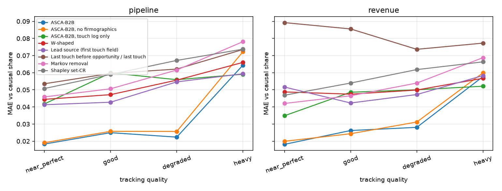
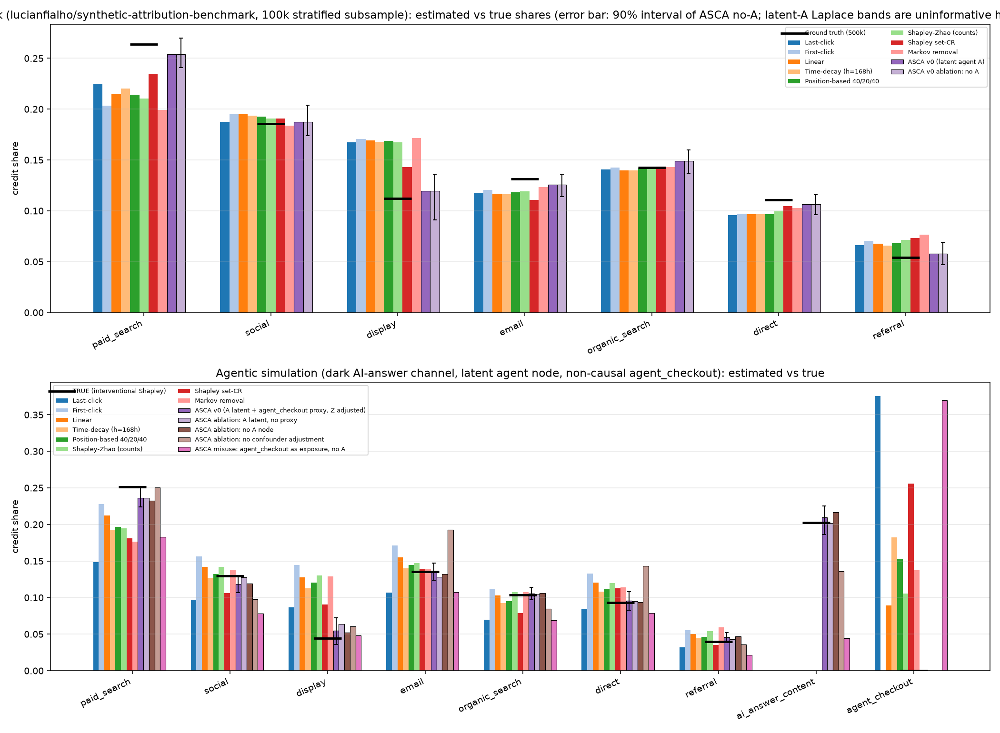

# ASCA-B2B: account-level attribution for B2B motions

ASCA (Agentic Structural Causal Attribution) asks, for each channel, what would have happened to pipeline and revenue without it. This version is built for B2B go-to-market: the account is the unit, a buying committee sits under that account, the funnel runs for months, and a lot of influence never shows up in the CRM.

The note has two parts. The first is for marketers and executives. The second is the technical record, including the consumer v0 benchmark as a secondary section. Every B2B number below comes from `run_b2b.py` (seed 17, 4,000 accounts). The tables are in `results/b2b/`.

## Contents

**For marketers and executives**

- [The B2B problem](#the-b2b-problem)
- [What ASCA does differently](#what-asca-does-differently)
- [What the B2B test showed](#what-the-b2b-test-showed)
- [When tracking falls apart](#when-tracking-falls-apart)
- [Limits, and the earlier consumer test](#limits-and-the-earlier-consumer-test)

**Technical reference**

- [No public B2B ground truth](#no-public-b2b-ground-truth)
- [The account-level model](#the-account-level-model)
- [Imperfect tracking](#imperfect-tracking)
- [How credit is scored](#how-credit-is-scored)
- [B2B baselines](#b2b-baselines)
- [Simulation](#simulation)
- [Reproduce](#reproduce)
- [B2B results](#b2b-results)
- [Assumptions and limitations](#assumptions-and-limitations)
- [Consumer v0 technical record](#consumer-v0-technical-record)

---

## For marketers and executives

### The B2B problem

A B2B deal is not a click that turns into an order. It is an account: several people, with different jobs, over several months. Someone on the buying team reads a review, sits in on a webinar, asks an AI assistant to build a shortlist, and only later does a sales rep log a meeting. The CRM then stores a single "lead source," or a W-shaped report that hands fixed slices of the deal to the first touch, the lead-creation touch, and the opportunity-creation touch.

Those reports answer "what was written down, and where did it sit in the sequence?" They do not answer "what caused the pipeline, and what caused the revenue?"

Three things make that gap large:

- **Targeting.** SDRs and ABM spend their time on accounts that were already a good fit. Those accounts win more often. A report that counts touches then gives SDR and ABM credit for a win that the fit would have produced anyway.
- **AI research with no trail.** Buyers use assistants to compare vendors. The research draws on your content, on review sites, and on mentions that never send a referrer. The CRM may later show an "AI-sourced" demo request or a self-reported "ChatGPT." That label is a record of the booking, not the thing that created the demand.
- **Sales activity after the deal exists.** Calls and meetings multiply once an opportunity is open, especially on attractive accounts. Last touch then points at the last sales activity and treats it as the cause of the revenue.

### What ASCA does differently

ASCA rolls the committee up to the account. A touch on an economic buyer counts more than the same touch on an end user. It adjusts for the firmographics that drive both targeting and win rates: fit, intent, whether you already know the account, and segment. It asks, for each channel, what would have happened to pipeline dollars and to closed-won dollars if that channel's exposure were removed and everything else, including the account's firmographics, stayed as it was.

The production log is treated as a noisy measurement of the exposure that actually happened, not as the exposure itself. A small measured panel is used to learn how often each channel survives into the log. LinkedIn and ABM also arrive as account-level impression totals, which do not depend on a cookie. Channels that leave almost no touch, in this test LLM research, are pinned with a randomized account holdout rather than with a referrer that is not there. Word of mouth has neither a usable touch log nor a holdout, so the model refuses to invent a share for it.

Sales calls after the decision date can affect whether an open opportunity closes. They are not allowed to create the opportunity. The AI-sourced flag is used only as a clue that an assistant was involved. It is not treated as a channel that spent money.

### What the B2B test showed

The test is a simulated book of 4,000 accounts (average 2.37 contacts, average deal size about $18,972). 1,374 accounts opened an opportunity (34.35%). 791 of those closed won (57.57% of opportunities). On 65.94% of opportunities a buyer had used an assistant to research vendors. On 27.29% the assistant also booked the demo, which is the observed "AI-sourced" flag. The right answer is known, because the simulation was built from an explicit causal model.

At the **good** tracking level (cookies and CRM both imperfect, but not broken), on a 0-to-1 split of credit:

| | Pipeline, average absolute error | Pipeline, rank agreement | Revenue, average absolute error | Revenue, rank agreement |
|---|---:|---:|---:|---:|
| ASCA-B2B | 0.0250 | 0.9393 | 0.0262 | 0.9143 |
| Lead source | 0.0427 | 0.4679 | 0.0423 | 0.4571 |
| W-shaped | 0.0472 | 0.2964 | 0.0475 | 0.3357 |
| Last touch | 0.0596 | 0.2036 | 0.0855 | 0.2509 |

Rank agreement is the Spearman correlation of the channel split with the true split. 1 means the order of channels matches exactly.

What the usual reports get wrong, at that same good tracking level:

- **Last touch** gave the AI-sourced flag 0.2724 of pipeline credit. The true share is 0. ASCA gave it 0. On revenue, last touch gave post-decision sales 0.8094 of the credit. The true sales share of revenue is 0.2154. ASCA gave sales 0.1332, and 0 of pipeline, which is the true pipeline share.
- **W-shaped** gave SDR 0.2147 of pipeline credit and 0.2243 of revenue credit. The true shares are 0.0872 and 0.0592. ASCA gave SDR 0.1205 and 0.1087. Dropping the firmographic adjustment made this worse: SDR's pipeline share rose to 0.1532 and its revenue share to 0.1439. ABM moved the same way (pipeline 0.1110 without the adjustment, 0.0943 with it, truth 0.0577).
- **Every path rule** gave LLM research at most 0.0052 of pipeline credit. The true share is 0.1765. ASCA, using the holdout rather than a referrer, gave it 0.1301. Word of mouth (truth 0.0166) and, at this tracking level, podcasts (truth 0.0176) stayed at 0, because the model had no touch log worth using and no experiment.

Near-perfect tracking is tighter still: pipeline error 0.0183 and revenue error 0.0182, with rank agreement 0.9250 and 0.9357. The 90% intervals from the posterior covered the truth for 73.33% of pipeline channels and 86.67% of revenue channels. Coverage on the channels the model could actually see was 76.92% and 92.31%. The misses are real: content's pipeline interval at good tracking was [-0.0172, 0.2191] against a truth of 0.2287, and the revenue interval for sales at near-perfect tracking was [0.0458, 0.1808] against 0.2154.

### When tracking falls apart

The same accounts were scored four times. Only the production log changed. The truth did not.

| Tracking | Pipeline error, ASCA | Pipeline error, best path rule in that row's set | Revenue error, ASCA | Revenue error, last touch |
|---|---:|---:|---:|---:|
| Near perfect | 0.0183 | 0.0407 (linear) | 0.0182 | 0.0892 |
| Good | 0.0250 | 0.0427 (lead source) | 0.0262 | 0.0855 |
| Degraded | 0.0224 | 0.0546 (lead source) | 0.0281 | 0.0736 |
| Heavy | 0.0644 | 0.0593 (lead source) | 0.0577 | 0.0773 |

"Best path rule" above is the lowest average absolute error among lead source, W-shaped, Z-shaped, linear, time-decay, last touch, Markov, and set-rate Shapley. At heavy tracking the raw-touch version of ASCA (0.0591) beat the full model (0.0644) on pipeline.

That jump is the channels that became invisible. With heavy loss, paid search, content, reviews, organic, podcasts, and word of mouth no longer had a usable touch log, and none of them had a holdout. ASCA set their pipeline credit to 0. Content's true share is 0.2287, so that single zero is most of the extra error. The intervals on those channels collapsed to 0 as well, which does **not** cover the truth. Intervals on the channels that remained visible (CRM-logged SDR, product-led signups, partner, events, plus LinkedIn and ABM via impression totals, plus LLM research via the holdout) still covered the truth 75% of the time. LinkedIn and ABM did not disappear, because the impression file does not depend on the cookie. LLM research did not disappear, because the holdout does not depend on a referrer. Word of mouth was unidentified at every tracking level. There is no experiment for it in this test, and its estimated keep rate never cleared the bar (0.0694 even when tracking was near perfect).

Path rules degrade more quietly and more misleadingly. Their error rises, and the rank agreement falls toward 0 (lead source's pipeline rank agreement at heavy tracking is -0.0286). They keep assigning the deals they can still see to SDR, to whatever lead source the form recorded, and to the last sales call.

### Limits, and the earlier consumer test

This B2B test was built by us, in the same family of formulas the model uses. The panel that calibrates the measurement stays high quality even when production tracking does not. The holdout is a real randomized suppression, not an observational trick. Those are favorable conditions. The heavy-tracking result is the caution: without an experiment or an impression file, a dark channel is not identified, and a confident 0 is the wrong interval.

An earlier consumer benchmark, on a public synthetic journey set and a separate agent simulation, is summarized in the technical record. In short: on that public set ASCA was the most accurate method and ranked the channels exactly right, and the benchmark favors ASCA's formula, which the write-up says plainly. In the consumer agent simulation, ASCA gave no credit to a checkout step that did not cause the sale, and it credited an invisible AI-answer channel worth about 20% of the true credit. Last touch gave that checkout step 37.5%.

| | Last touch | ASCA |
|---|---|---|
| Credit to the checkout step that did not cause the sale | 37.5% | none |
| Credit to the invisible AI-answer channel (true share about 20%) | none | credited, close to the true share |

---

## Technical reference

### No public B2B ground truth

There is no public B2B, account-level, multi-touch dataset with causal ground truth that this benchmark can score against. Criteo's public attribution set is consumer display traffic, hashed, with no ground truth. A 2025 causal-attribution paper (arXiv:2512.21211) reports the same gap after a long search and falls back to simulation. Published B2B comparisons that quote enterprise logs do not release the accounts. Amazon's RCT ground truth for its own ads is internal. The Hugging Face set `lucianfialho/synthetic-attribution-benchmark` (CC BY 4.0) is the consumer journey benchmark already in this repo. The B2B numbers here are from the seeded simulation only.

### The account-level model

An account $a$ has firmographics $`Z_a`$: ICP fit, intent, an existing-relationship flag, and segment indicators for mid-market and enterprise. Contacts carry roles. Role weights are economic buyer 1.30, champion 1.15, technical evaluator 0.80, end user 0.40. Marketing exposure is the role-weighted, decayed sum of touches before the decision date (day 110), with half-life 45 days:

$$
E_{ac} = \sum_{\text{touches of } c} w_{\text{role}} \exp\left(-\frac{\ln 2}{45}(110 - t)\right), \qquad s_{ac} = \frac{E_{ac}}{1 + E_{ac}}.
$$

A latent agent $A$ (the buyer used an assistant to build the shortlist) has

$$
\mathrm{logit} P(A=1 \mid s, Z) = a_0 + g \cdot s_{\text{agent}} + z_A \cdot Z,
$$

with loadings on content, review sites, LLM research, and podcasts. The AI-executed demo flag $M$ is a descendant: it fires only if $A=1$ and the account becomes an opportunity, with probability 0.42. IAB class is then human-owned ($A=0$), AI-assisted ($A=1$, no executed demo), or AI-executed ($M=1$). $M$ is a proxy in the likelihood. It is not an exposure, except in the misuse ablation.

Opportunity and win, with $A$ marginalized:

```math
\begin{aligned}
P(Y=1 \mid s, Z) &= (1-\pi)\,\sigma(\eta_Y) + \pi\,\sigma(\eta_Y + d_Y), \\ 
P(W=1 \mid Y=1, s, Z, s_{\text{sales}}) &= (1-\pi)\,\sigma(\eta_W) + \pi\,\sigma(\eta_W + d_W).
\end{aligned}
```

$`\eta_Y`$ does not include sales. $`\eta_W`$ includes $`\delta \cdot s_{\text{sales}}`$. Sales intensity has a firmographic part and a large idiosyncratic part, so $\delta$ is not the same coefficient as ICP. Post-decision calls are what the path rules count. The win likelihood uses a CRM effort score, a noisy reading of that intensity on opportunities the CRM recorded. Pipeline value of a coalition is $\mathrm{ACV} \times P(Y=1 \mid do)$. Revenue value is $\mathrm{ACV} \times P(Y=1 \mid do) \times P(W=1 \mid Y=1, do)$. Credit is the exact Shapley value of that function over the 14 channels (13 marketing channels plus sales). Shares are the channels' fractions of total incremental dollars. `ai_sourced` is scored as well and has truth 0.

The fitted model is this same two-equation SCM. Channel effects, agent loadings, and $\delta$ are constrained to be non-negative. Priors are $\mathcal{N}(0, 5^2)$ on intercepts, $\mathcal{N}(0, 2^2)$ on effects, and $\mathcal{N}(0, 1.5^2)$ on the proxy log-odds. The full model at each tracking level was sampled with NUTS in NumPyro: 100 warmup steps, 50 draws, one chain, 0 divergences. Ablations (no firmographics, touch log only, and the misuse that puts the AI-sourced flag in the opportunity equation) are MAP only, so they have no posterior intervals.

### Imperfect tracking

The truth is simulated once. Four production logs are then drawn with quality $`q \in \{1.00, 0.72, 0.42, 0.18\}`$ (near perfect, good, degraded, heavy). A true touch of channel $c$ is kept with probability $`\text{base}_c \times (\text{floor} + (1-\text{floor}) q)`$. Floors are 0.08 for cookie channels, 0.30 for offline, 0.80 for CRM-native channels (SDR, partner, product-led, sales), and 0 for dark channels. Kept touches match the right account with probability $0.50 + 0.45q$, land on a random wrong account with probability $0.06(1-q)$, and are otherwise dropped. The lead-source field falls back to a biased self-report (events, SDR, podcasts, reviews, and a ChatGPT label) with probability $0.25 + 0.55(1-q)$. MQA dates are often missing and late. Opportunity and win flags are dropped with probabilities that rise as $q$ falls. LinkedIn and ABM also emit a noisy account-level impression total; the noise grows as $q$ falls.

On a 10% gold panel the production exposure and the true exposure are both observed. That panel is used only to fit, per channel,

$$
E^{\text{true}} \approx \alpha + \beta E^{\text{obs}} + \gamma E^{\text{agg}} + \theta \cdot Z
$$

and to apply the fit to every account. It is not copied into the outcome regression as the true dose. Randomized holdouts (8% of accounts for ABM, a disjoint 8% for LLM research) set that channel's reconstructed exposure to 0. A channel whose gold-panel keep rate is below 0.15, and which has neither an impression total nor the LLM holdout, is set to zero exposure and called unidentified. In this run that is:

| Channel | Near perfect | Good | Degraded | Heavy |
|---|---|---|---|---|
| Word of mouth | unidentified | unidentified | unidentified | unidentified |
| Podcast | touch log (keep rate 0.1845) | unidentified (0.1012) | unidentified (0.0647) | unidentified (0.0514) |
| Paid search, content, review, organic | calibrated touch log | calibrated touch log | calibrated touch log | unidentified |
| LinkedIn, ABM | impression totals | impression totals | impression totals | impression totals |
| LLM research | holdout, not the touch log | holdout | holdout | holdout |
| SDR, partner, product-led, events | calibrated touch log | calibrated touch log | calibrated touch log | calibrated touch log |

Keep rates in parentheses are the gold-panel estimates $p$ from `results/b2b/identification.csv`. The touch log for LLM research is never used, even when a few referrals survive (estimated keep rate 0.0520 at near-perfect tracking).

Unidentified channels get a point share of 0 and a posterior interval that collapses to 0, because the value function does not depend on a coefficient that multiplies a column of zeros. That interval is not a calibrated statement of ignorance. Overall 90% coverage and coverage on identified channels are both reported. At heavy tracking the overall pipeline coverage is 0.4667 and the identified-channel coverage is 0.7500.

### How credit is scored

Truth shares use each account's true saturated exposure and its structural sales intensity, including the intensity a non-opportunity would have fielded. Published ASCA shares use the reconstructed exposures and a sales intensity that is the logged effort score on recorded opportunities and the firmographic prediction elsewhere. Both are normalized by total incremental dollars, so the comparison is a share vector, not a dollar total. Path rules are scored the same way: on each CRM-visible opportunity or win, the rule splits that account's ACV across observed touches, the dollars are summed, and the vector is normalized. Bootstrap intervals for path rules resample accounts (24 resamples, 5th and 95th percentiles).

### B2B baselines

All of these see only the production log for that tracking level. They do not see the gold panel, the holdouts, firmographics, or true exposures.

- **Lead source.** 100% of the deal to the CRM lead-source field.
- **Last touch.** Last observed touch before day 110 for pipeline; last observed touch in the whole log for revenue.
- **W-shaped.** 30% first touch, 30% the touch nearest the CRM MQA date, 30% last touch before day 110, 10% across the other touches.
- **Z-shaped / full path.** 20% on first, lead, opportunity, and last touch, and 20% across the rest.
- **Linear and time-decay.** Time-decay uses the 45-day half-life, which matches the simulation and favors that rule.
- **Markov removal and set-rate Shapley.** The v0 implementations, on the observed path, with per-account credit dollar-weighted. Set-rate Shapley uses $v(\emptyset) = 0$.

The touch-only ASCA ablation is the same outcome model fit to raw observed exposure, with no calibration, no impression totals, and no holdout column. The no-firmographics ablation keeps the measurement layer and drops $Z$ from the outcome equations.

### Simulation

`b2b/simulate.py` documents the coefficients. Marketing touches are Poisson, with extra rate for SDR, ABM, and LinkedIn on high-ICP, high-intent, and enterprise accounts. ABM is suppressed on its holdout and LLM research on its holdout, before any outcomes are drawn. Opportunity and win are the two structural stages. MQA and SQL dates are operational timestamps for the path rules (MQA is the day of the second marketing touch; SQL is seven days before the decision on opportunities). They are not extra structural equations. A continuous-time hazard is not fit. The decision date is fixed at day 110 so "before the opportunity" is well defined; close is day 160 for wins. The window is 180 days.

Ground-truth pipeline share for sales is 0 (numerical value $1.7 \times 10^{-17}$ in this run). Incremental dollars, summing Shapley over accounts, were 22,612,563.95 of pipeline and 16,713,952.70 of revenue. IAB counts across all accounts: human-owned 2,037, AI-assisted 1,588, AI-executed 375.

Committed tables, regenerated by the script: `data/b2b/accounts.parquet`, `contacts.parquet`, `touches_true.parquet`, `touches_observed_good.parquet` (the good tracking log only; the other three logs are redrawn from the seed), and `exposure_true.parquet`.

### Reproduce

```bash
python -m venv .venv && . .venv/bin/activate && pip install -r requirements.txt
python run_b2b.py --n 4000 --seed 17 --method nuts --nuts-warmup 100 --nuts-samples 50 --boot 24
```

`requirements.txt` adds `jax` and `numpyro` to the v0 list. The run that produced these tables used NumPyro 0.22 and JAX 0.12. If NUTS diverges on more than 10% of draws, or fails to import, `fit_asca` falls back to a Laplace approximation at the MAP and records that in the fit note. This run had 0 divergences at every tracking level. Wall time on this machine was about 29 minutes, most of it the Shapley values on posterior draws.

The consumer benchmark is unchanged: `python download_data.py` then `python run_benchmark.py 100000` and `python run_simulation.py`. Do not expect to re-run those for the numbers in the consumer section; they are the completed v0 outputs.

### B2B results

Average absolute error (MAE) and Spearman rank correlation. Full rows, including MaxAE, Kendall, and both coverages, are in `results/b2b/scores.md`.

**Pipeline**

| Tracking | ASCA | ASCA, no firmographics | ASCA, touch log only | Lead source | W-shaped | Last touch | Linear |
|---|---:|---:|---:|---:|---:|---:|---:|
| Near perfect | 0.0183 | 0.0191 | 0.0417 | 0.0413 | 0.0444 | 0.0535 | 0.0407 |
| Good | 0.0250 | 0.0257 | 0.0599 | 0.0427 | 0.0472 | 0.0596 | 0.0463 |
| Degraded | 0.0224 | 0.0257 | 0.0559 | 0.0546 | 0.0556 | 0.0621 | 0.0549 |
| Heavy | 0.0644 | 0.0722 | 0.0591 | 0.0593 | 0.0660 | 0.0735 | 0.0667 |

Spearman for ASCA pipeline: 0.9250, 0.9393, 0.9000, 0.2857. For lead source: 0.5393, 0.4679, 0.1714, −0.0286.

**Revenue**

| Tracking | ASCA | ASCA, no firmographics | ASCA, touch log only | Lead source | W-shaped | Z-shaped | Last touch | Linear |
|---|---:|---:|---:|---:|---:|---:|---:|---:|
| Near perfect | 0.0182 | 0.0199 | 0.0349 | 0.0516 | 0.0488 | 0.0338 | 0.0892 | 0.0324 |
| Good | 0.0262 | 0.0244 | 0.0486 | 0.0423 | 0.0475 | 0.0368 | 0.0855 | 0.0367 |
| Degraded | 0.0281 | 0.0312 | 0.0500 | 0.0472 | 0.0499 | 0.0413 | 0.0736 | 0.0437 |
| Heavy | 0.0577 | 0.0599 | 0.0521 | 0.0583 | 0.0567 | 0.0521 | 0.0773 | 0.0543 |

At good tracking, dropping firmographics has a slightly lower revenue MAE (0.0244 against 0.0262) and a slightly higher Spearman (0.9250 against 0.9143). The share table shows what that average hides: SDR and ABM are further from the truth without the adjustment. The misuse ablation, which puts the AI-sourced flag into the opportunity equation while the reported share for that flag stays 0, raised pipeline MAE from 0.0250 to 0.0318 and lowered revenue MAE from 0.0262 to 0.0239. It is not a better account of the flag.

**Channel shares at good tracking**

Pipeline:

| Channel | Truth | ASCA | No firmographics | W-shaped | Last touch | Lead source |
|---|---:|---:|---:|---:|---:|---:|
| paid_search | 0.1053 | 0.1303 | 0.1228 | 0.1394 | 0.1170 | 0.0936 |
| linkedin | 0.0843 | 0.0905 | 0.1162 | 0.0565 | 0.0431 | 0.0803 |
| content | 0.2287 | 0.1248 | 0.1243 | 0.1691 | 0.1343 | 0.1516 |
| events | 0.0276 | 0.0249 | 0.0242 | 0.0284 | 0.0206 | 0.0629 |
| sdr | 0.0872 | 0.1205 | 0.1532 | 0.2147 | 0.1810 | 0.1763 |
| partner | 0.0210 | 0.0423 | 0.0206 | 0.0383 | 0.0360 | 0.0608 |
| review | 0.0761 | 0.1202 | 0.0633 | 0.0288 | 0.0225 | 0.0517 |
| organic | 0.0384 | 0.0499 | 0.0006 | 0.0711 | 0.0588 | 0.0662 |
| plg | 0.0629 | 0.0722 | 0.0645 | 0.0748 | 0.0568 | 0.0653 |
| abm | 0.0577 | 0.0943 | 0.1110 | 0.0317 | 0.0194 | 0.0293 |
| llm_research | 0.1765 | 0.1301 | 0.1993 | 0.0041 | 0.0017 | 0.0048 |
| wom | 0.0166 | 0 | 0 | 0.0072 | 0.0018 | 0.0134 |
| podcast | 0.0176 | 0 | 0 | 0.0065 | 0.0011 | 0.0411 |
| sales_ae | 0 | 0 | 0 | 0.0437 | 0.0336 | 0.0619 |
| ai_sourced | 0 | 0 | 0 | 0.0856 | 0.2724 | 0.0409 |

Revenue:

| Channel | Truth | ASCA | No firmographics | W-shaped | Last touch | Lead source |
|---|---:|---:|---:|---:|---:|---:|
| paid_search | 0.0723 | 0.0850 | 0.0835 | 0.1160 | 0.0295 | 0.0675 |
| linkedin | 0.0617 | 0.0706 | 0.0941 | 0.0493 | 0.0175 | 0.0637 |
| content | 0.1719 | 0.1567 | 0.1442 | 0.1663 | 0.0326 | 0.1654 |
| events | 0.0366 | 0.0222 | 0.0196 | 0.0278 | 0.0028 | 0.0577 |
| sdr | 0.0592 | 0.1087 | 0.1439 | 0.2243 | 0.0310 | 0.1875 |
| partner | 0.0233 | 0.0544 | 0.0369 | 0.0385 | 0.0056 | 0.0606 |
| review | 0.0639 | 0.1231 | 0.0518 | 0.0340 | 0.0000 | 0.0630 |
| organic | 0.0280 | 0.0438 | 0.0039 | 0.0692 | 0.0104 | 0.0716 |
| plg | 0.0520 | 0.0521 | 0.0469 | 0.0591 | 0.0053 | 0.0586 |
| abm | 0.0438 | 0.0630 | 0.0764 | 0.0343 | 0.0064 | 0.0278 |
| llm_research | 0.1428 | 0.0873 | 0.1508 | 0.0019 | 0.0000 | 0.0027 |
| wom | 0.0145 | 0 | 0 | 0.0064 | 0.0019 | 0.0101 |
| podcast | 0.0148 | 0 | 0 | 0.0036 | 0.0000 | 0.0466 |
| sales_ae | 0.2154 | 0.1332 | 0.1478 | 0.0857 | 0.8094 | 0.0709 |
| ai_sourced | 0 | 0 | 0 | 0.0836 | 0.0475 | 0.0463 |

ASCA's 90% posterior intervals at good tracking, pipeline, are in `results/b2b/intervals.csv`. The chart is `results/b2b/tracking_sweep.png`.



### Assumptions and limitations

- The simulation uses the same saturated-exposure, logistic, latent-agent family the estimator assumes. Half-life (45 days) and saturation scale (1) are treated as known. Errors on a different family would be larger. The consumer v0 write-up makes the same point about its own benchmark.
- The gold panel does not degrade with production tracking. A real measurement study can be run that way; it is also an optimistic assumption if the panel is just "the best cookies."
- MQA and SQL are timestamps for the path rules, not structural stages. There is no continuous-time hazard, so touches are not censored at a random conversion time. Every marketing touch is before day 110 by construction.
- Unidentified channels are reported as a point mass at 0. That understates uncertainty. Coverage on the full channel list falls for that reason, and the identified-channel coverage is the one that speaks to calibration where the model has a signal.
- NUTS used 50 draws after 100 warmup steps. Quantiles of channel shares from 50 draws are coarse. Ablations have no intervals.
- Revenue shares for sales are the hardest structural piece. Even with an effort score, near-perfect tracking put sales at 0.1526 against a truth of 0.2154, and the 90% interval [0.0458, 0.1808] did not cover the truth. Path rules miss in the other direction: last touch's revenue MaxAE is 0.6359 at near-perfect tracking and 0.5940 at good tracking, which is the sales column.
- No public B2B ground truth was available to confirm any of this outside the simulation.

### Files added for B2B

- `b2b/`: simulation, observation layer, truth, baselines, model.
- `run_b2b.py`: one seeded run, four tracking levels, writes `results/b2b/`.
- `data/b2b/`: accounts, contacts, true touches, the good-tracking observed touches, true exposures.
- `results/b2b/scores.csv`, `shares.csv`, `intervals.csv`, `identification.csv`, `summary.json`, `scores.md`, `tracking_sweep.png`.

---

## Consumer v0 technical record

### The model

ASCA v0 (`asca/model.py`) is a structural causal model per journey $j$ and channel $c$. The pieces are:

- **Exposures** $X$: the measured marketing contacts, including a dark channel when its impressions are logged.
- **Latent agent node** $A$: whether an assistant mediated the journey. $A$ is not observed.
- **Confounders / segment** $Z$: observed pre-treatment covariates (the backdoor set). In the simulation, $Z$ is a high-intent segment.
- **Outcome** $Y$: conversion.
- **Proxy** $M$ (optional): an observed AI-executed checkout. $M$ is a descendant of $A$ and $Y$. It is never an exposure.

```math
\begin{aligned}
\mathrm{logit} P(A=1 \mid X, Z) &= a_0 + g \cdot s + z_A \cdot Z \\ 
\mathrm{logit} P(Y=1 \mid X, A, Z) &= b_0 + b \cdot s + d \cdot A + z_Y \cdot Z
\end{aligned}
```

$s$ is saturated exposure, defined below. The benchmark has no agent node. The simulation does.

#### Exposure decay and saturation

Half-life $h$ and saturation scale $\kappa$ are free parameters.

```math
E_{jc}(h) = \sum_{\text{touches of } c} \exp\!\left(-\frac{\ln 2}{h}\,(T_{\mathrm{end}} - t)\right)
```

$$
s_{jc} = \frac{E_{jc}}{\kappa + E_{jc}}
$$

Outcomes are evaluated at $`T_{\mathrm{end}} = 720\,\mathrm{h}`$, because the benchmark has no conversion timestamps. The benchmark's own decay uses a fixed half-life of $`168\,\mathrm{h}`$ inside the same window. See [Data](#data).

#### Likelihood, with $A$ marginalized

$A$ is latent and is marginalized out of the likelihood. With $\pi = P(A=1 \mid X, Z)$ and $`\eta = b_0 + b \cdot s + z_Y \cdot Z`$,

```math
P(Y=1 \mid X, Z) = (1-\pi)\,\sigma(\eta) + \pi\,\sigma(\eta + d)
```

and $P(Y=0 \mid X, Z)$ is the complementary mixture. If the agent node is turned off, the likelihood is ordinary logistic regression of $Y$ on $s$ and $Z$.

#### The checkout flag is a descendant, not an exposure

The optional proxy is

```math
M \mid Y=1,\, A \sim \mathrm{Bernoulli}(q \cdot A)
```

$M$ is the observed AI-executed checkout. Because it is a descendant of $A$ and $Y$, conditioning on it as if it were a marketing exposure is a post-treatment error. That misuse is one of the reported ablations: it is about as bad as last-click. With the proxy in the likelihood, a conversion with $M=1$ is attributed only to paths with $A=1$, since $P(M=1 \mid A=0) = 0$ under this specification.

#### Inference

MAP with weakly informative Gaussian priors: $\mathcal{N}(0, 2^2)$ on effects, $\mathcal{N}(0, 5^2)$ on intercepts, $`\log h \sim \mathcal{N}(\log 100,\, 2^2)`$, and $`\log \kappa \sim \mathcal{N}(0,\, 2^2)`$.

Uncertainty is a Laplace approximation. The Hessian is finite-differenced. Reported intervals use 200 posterior draws. Laplace is a Gaussian approximation, not MCMC. PyMC and numpyro were not used. The intervals reflect parameter uncertainty only, and they ignore the model-selection step.

### How credit is assigned

#### Interventional credit

For each converting journey, the value of a coalition $S$ of channels is the expected outcome after intervening to keep that journey's exposures in $S$ and to set every other channel to zero, still conditioning on the journey's $Z$:

```math
v_j(S) = \mathbb{E}\!\left[Y \mid do(X_S = x_{jS},\, X_{-S} = 0),\, Z_j\right]
```

$`\varphi_j`$ is the exact Shapley value of $`v_j`$ over all $2^K$ coalitions. Rows are normalized to sum to 1 and then averaged across converting journeys. That is the same convention as the benchmark's `aggregate_true_contribution`: each converting journey counts equally.

Incremental conversions are

$$
\sum_j \left[v_j(\mathrm{all}) - v_j(\emptyset)\right]
$$

taken over all journeys, not only converters, and allocated by the un-normalized Shapley values.

#### Path-specific credit through the agent

The fraction of a channel's credit that flows through $A$ is

$$
1 - \frac{\varphi^{\mathrm{dir}}}{\varphi^{\mathrm{tot}}}
$$

where $\varphi^{\mathrm{dir}}$ is the Shapley value with the $A$-equation held at $X = 0$ (only the direct $X \to Y$ path is active). Separating $X \to A \to Y$ from $X \to Y$ needs an observed proxy for $A$. With the proxy, the mediated fractions are recovered roughly. Without it, they are not identified: some fractions come out negative and others above 1.

Total shares are a different question. They come out about the same with or without $A$ (MAE 0.0055–0.0071 on the simulation), because the marginal $P(Y \mid X)$ is close to logistic either way. The latent agent node is mainly needed for path-specific credit.

### Baselines

Every baseline produces credit per converting journey. Each journey's credit is normalized to 1, then averaged, matching the ground-truth convention.

- **Last-click, first-click, linear.**
- **Time-decay:** half-life $`168\,\mathrm{h}`$, measured back from $`t = 720\,\mathrm{h}`$. That half-life equals the data-generating half-life, which helps time-decay.
- **Position-based:** 40/20/40.
- **Markov:** a first-order chain with removal effect. The aggregate share is the normalized removal effect. Per journey, the removal effect is spread across the channels present. That per-journey split is an approximation.
- **Shapley-Zhao (counts):** $`v(S) = \sum_{T \subseteq S} \mathrm{conv}(T)`$. This reduces to an equal split across the distinct channels in a journey.
- **Shapley set-CR:** for each converting journey, exact Shapley with $v(S)$ equal to the empirical conversion rate of journeys whose exact channel set is $S$. Here $v(\emptyset) = 0$, unseen sets count as 0, and negative values are clipped.

### Data

**Public benchmark.** Hugging Face [`lucianfialho/synthetic-attribution-benchmark`](https://huggingface.co/datasets/lucianfialho/synthetic-attribution-benchmark) v2 (CC BY 4.0), downloaded into `data/`. The full set has 500,000 journeys, 1,349,161 touchpoints, and 29,938 conversions (5.99%).

The scored subsample is 100,000 journeys stratified on `converted`, seed 7. That gives 5,988 conversions (5.988% vs 5.988% in the full set) and 269,817 touchpoints. `results/benchmark_scores.md` records the same subsample as `conv_rate_sub` 0.05988 and `conv_rate_full` 0.059876.

The data-generating process, checked in code, is

```math
p = \sigma\!\left(-3.2 + \sum_c w_c \cdot s(D_c)\right), \quad s(x) = \frac{x}{1+x}, \quad D_c = \sum \exp\!\left(-\frac{\ln 2}{168\,\mathrm{h}}\,(720 - t)\right)
```

This reproduces `conv_prob` to 6e-7. For every converting journey, $`\sum_c \mathrm{gt\_shapley}_c = \mathrm{conv\_prob} - \sigma(-3.2)`$, with error 5e-7.

Channel weights: paid_search 1.1, social 0.7, display 0.35, email 0.9, organic_search 0.8, direct 1.0, referral 0.5.

Truth for scoring is `aggregate_true_contribution` from `ground_truth.json`, built from per-journey normalized Shapley values with each conversion weighted equally. The same quantity is also recomputed on the subsample.

`dda_comparison_results.json` on the hub has different "gt_shapley" numbers. They look like the v1 aggregation convention, so they were not used.

**Agentic simulation.** `run_simulation.py` builds its own journeys with an explicit agent node. It has 200,000 journeys and 17,907 conversions (8.95%). 50.1% of conversions are agent-mediated ($A = 1$). 37.5% of conversions show an observed `agent_checkout`. The file header in `results/simulation_scores.md` is `N=200000`, conversions `17907` (`0.0895`), agent-mediated conversions `0.501`, observed `agent_checkout` among conversions `0.375`.

Truth on the simulation is interventional Shapley under the true structural model. The truth for `agent_checkout` is 0. The dark channel `ai_answer_content` is logged impressions of brand content inside LLM answers: ASCA sees it as an exposure, and the path models do not.

### Download and reproduce

`journeys.parquet` and `touchpoints.parquet` are not in git (see `.gitignore`). On the hub they are Git LFS files at the **repository root** of [`lucianfialho/synthetic-attribution-benchmark`](https://huggingface.co/datasets/lucianfialho/synthetic-attribution-benchmark), revision `main` (commit `293a1054afa9ab1abefb21ab2ff14914d7bb52f0`). There is no `data/` directory on the hub.

| Hub path | Size | In this repo |
|---|---|---|
| `journeys.parquet` | 5,472,065 bytes | download to `data/journeys.parquet` |
| `touchpoints.parquet` | 12,772,646 bytes | download to `data/touchpoints.parquet` |
| `ground_truth.json` | 1,136 bytes | committed as `data/ground_truth.json` |

The same commit also has PNGs, notebooks, and `dda_comparison_results.json`. This project does not use those. The hub tags the repo `format:imagefolder` because of the PNGs, so `datasets.load_dataset` does not return the journey tables. `download_data.py` uses `huggingface_hub.hf_hub_download` and writes the two parquet files into `data/`.

```bash
python download_data.py
```

`requirements.txt` is numpy, pandas, scipy, pyarrow, matplotlib, tabulate, and huggingface_hub. Nothing in this repo imports scikit-learn.

```bash
python -m venv .venv && . .venv/bin/activate && pip install -r requirements.txt && python download_data.py && python run_benchmark.py 100000 && python run_simulation.py && python make_charts.py
```

`run_benchmark.py` reads the parquet files. `run_simulation.py` and `make_charts.py` do not. The simulation took about 27 minutes in total. Gradients are finite differences, which is why.

### Results

#### Benchmark (100k subsample, scored against the 500k truth)

| model | MAE | MaxAE | Spearman | Kendall | MAE vs subsample truth | per-journey MAE | 90% coverage |
|---|---|---|---|---|---|---|---|
| ASCA v0 ablation: no A | 0.0057 | 0.0098 | 1.0000 | 1.0000 | 0.0047 | 0.0069 | 1.0000 |
| ASCA v0 (latent agent A) | 0.0057 | 0.0098 | 1.0000 | 1.0000 | 0.0047 | 0.0069 | 1.0000 |
| Shapley set-CR | 0.0160 | 0.0308 | 0.9643 | 0.9048 | 0.0153 | 0.0484 | 0.4286 |
| Last-click | 0.0198 | 0.0551 | 0.8929 | 0.8095 | 0.0194 | 0.1032 | |
| Time-decay (h=168h) | 0.0216 | 0.0558 | 0.8929 | 0.8095 | 0.0211 | 0.0282 | |
| Shapley-Zhao (counts) | 0.0223 | 0.0555 | 0.8929 | 0.8095 | 0.0218 | 0.0516 | |
| Position-based 40/20/40 | 0.0223 | 0.0568 | 0.8929 | 0.8095 | 0.0218 | 0.0589 | |
| Linear | 0.0230 | 0.0572 | 0.8929 | 0.8095 | 0.0226 | 0.0489 | |
| Markov removal | 0.0236 | 0.0644 | 0.8929 | 0.8095 | 0.0233 | 0.0532 | 0.2857 |
| First-click | 0.0242 | 0.0604 | 0.8929 | 0.8095 | 0.0237 | 0.1696 | |

Blank coverage cells were not computed. ASCA's MAE is 0.0057, against 0.016 for the best baseline (set-CR) and 0.020–0.024 for the heuristics. Spearman 1.000 means the channel ranking is exactly right. Per-journey MAE is 4–25× lower than the baselines. The previous summary rounded Spearman and Kendall to three decimals: 0.964 and 0.905 for set-CR, and 0.893 and 0.810 for every path heuristic. The table above is the four-decimal printout in `results/benchmark_scores.md`.

**ASCA no-A 90% intervals** (Laplace posterior). These are the bands plotted on the benchmark chart.

| channel | interval | truth |
|---|---|---|
| paid_search | [0.241, 0.270] | 0.264 |
| social | [0.174, 0.204] | 0.186 |
| display | [0.091, 0.136] | 0.112 |
| email | [0.114, 0.136] | 0.131 |
| organic_search | [0.137, 0.160] | 0.143 |
| direct | [0.096, 0.116] | 0.111 |
| referral | [0.047, 0.069] | 0.054 |

All 7 intervals contain the truth. The bootstrap intervals for Markov cover only 2 of 7 channels, and set-CR covers 3 of 7. Those bands are tight around biased values. The latent-A Laplace bands on this benchmark are a different object: coverage in the score table is 1.0000 only because the intervals are huge. They are uninformative and include negative values. From `results/benchmark_intervals.csv`:

| channel | Markov removal | Shapley set-CR | ASCA v0 (latent agent A) | ASCA v0 ablation: no A |
|---|---|---|---|---|
| paid_search | [0.196, 0.202] | [0.206, 0.248] | [0.188, 0.564] | [0.241, 0.270] |
| social | [0.181, 0.188] | [0.170, 0.214] | [-0.030, 0.361] | [0.174, 0.204] |
| display | [0.169, 0.174] | [0.126, 0.158] | [-0.541, 0.216] | [0.091, 0.136] |
| email | [0.119, 0.125] | [0.093, 0.126] | [0.099, 0.262] | [0.114, 0.136] |
| organic_search | [0.141, 0.146] | [0.129, 0.158] | [0.112, 0.332] | [0.137, 0.160] |
| direct | [0.101, 0.105] | [0.093, 0.120] | [0.085, 0.268] | [0.096, 0.116] |
| referral | [0.074, 0.079] | [0.063, 0.090] | [-0.188, 0.118] | [0.047, 0.069] |

**Fitted shape.** $`h = 179\,\mathrm{h}`$ (truth $`168\,\mathrm{h}`$), $\kappa = 0.81$ (truth 1). The estimated weights are smaller than the true ones but in the same order, because $\kappa$ and the $`w_c`$ trade off against each other.

**Incremental conversions.** ASCA implies 2,166 incremental conversions. The truth on the subsample, $`\sum(\mathrm{conv\_prob} - \sigma(-3.2))`$, is 2,113, so ASCA is 2.5% high.

**Agent node on this data.** The benchmark has no agent node. The latent-A model learns $d = 0.01$ with posterior sd 2.45, which is just the prior. It correctly collapses to the no-A model, and its shares are identical.

Channel shares (`results/benchmark_shares.csv`):

| model | paid_search | social | display | email | organic_search | direct | referral |
|---|---|---|---|---|---|---|---|
| Last-click | 0.2248 | 0.1877 | 0.1672 | 0.1176 | 0.1408 | 0.0959 | 0.0661 |
| First-click | 0.2034 | 0.1951 | 0.1707 | 0.1207 | 0.1428 | 0.0970 | 0.0703 |
| Linear | 0.2145 | 0.1950 | 0.1692 | 0.1168 | 0.1399 | 0.0966 | 0.0679 |
| Time-decay (h=168h) | 0.2201 | 0.1935 | 0.1679 | 0.1165 | 0.1397 | 0.0965 | 0.0658 |
| Position-based 40/20/40 | 0.2139 | 0.1929 | 0.1688 | 0.1183 | 0.1416 | 0.0966 | 0.0680 |
| Shapley-Zhao (counts) | 0.2106 | 0.1907 | 0.1675 | 0.1192 | 0.1411 | 0.0996 | 0.0713 |
| Shapley set-CR | 0.2346 | 0.1905 | 0.1429 | 0.1105 | 0.1436 | 0.1046 | 0.0733 |
| Markov removal | 0.1994 | 0.1836 | 0.1718 | 0.1231 | 0.1429 | 0.1027 | 0.0765 |
| ASCA v0 (latent agent A) | 0.2540 | 0.1875 | 0.1195 | 0.1256 | 0.1492 | 0.1064 | 0.0578 |
| ASCA v0 ablation: no A | 0.2541 | 0.1875 | 0.1194 | 0.1256 | 0.1492 | 0.1064 | 0.0579 |
| Ground truth (500k) | 0.2638 | 0.1856 | 0.1120 | 0.1313 | 0.1425 | 0.1107 | 0.0540 |
| Ground truth (subsample) | 0.2617 | 0.1864 | 0.1119 | 0.1286 | 0.1444 | 0.1121 | 0.0549 |

All path heuristics over-credit display and referral, which appear often but have low weight, and under-credit paid_search by 3–6 points. They reward frequency in paths, not causal effect.

#### Agent simulation (truth = interventional Shapley under the true model)

| model | MAE | MaxAE | Spearman | Kendall | per-journey MAE | credit to agent_checkout (truth 0) | credit to dark AI channel (truth 0.202) | 90% coverage |
|---|---|---|---|---|---|---|---|---|
| ASCA ablation: A latent, no proxy | 0.0055 | 0.0198 | 1.0000 | 1.0000 | 0.0082 | 0.0000 | 0.2020 | 1.0000 |
| ASCA v0 (A + proxy + Z) | 0.0060 | 0.0151 | 1.0000 | 1.0000 | 0.0071 | 0.0000 | 0.2094 | 0.7778 |
| ASCA ablation: no A node | 0.0071 | 0.0187 | 1.0000 | 1.0000 | 0.0083 | 0.0000 | 0.2170 | 0.6667 |
| ASCA ablation: no confounder adjustment | 0.0274 | 0.0665 | 0.8667 | 0.7778 | 0.0351 | 0.0000 | 0.1358 | 0.3333 |
| First-click | 0.0502 | 0.2023 | 0.5272 | 0.4789 | 0.1627 | 0.0000 | 0.0000 | |
| Linear | 0.0538 | 0.2023 | 0.4500 | 0.3889 | 0.0787 | 0.0894 | 0.0000 | |
| Shapley-Zhao (counts) | 0.0576 | 0.2023 | 0.4500 | 0.3889 | 0.0840 | 0.1054 | 0.0000 | |
| Position-based 40/20/40 | 0.0591 | 0.2023 | 0.1167 | 0.1111 | 0.1029 | 0.1529 | 0.0000 | |
| Time-decay (h=168h) | 0.0611 | 0.2023 | 0.1167 | 0.1111 | 0.0806 | 0.1826 | 0.0000 | |
| Markov removal | 0.0617 | 0.2023 | 0.3000 | 0.2222 | 0.0820 | 0.1375 | 0.0000 | |
| Shapley set-CR | 0.0723 | 0.2558 | −0.0333 | 0.0556 | 0.1032 | 0.2558 | 0.0000 | |
| ASCA misuse (checkout as an exposure) | 0.0831 | 0.3698 | 0.1000 | 0.1667 | 0.1030 | 0.3698 | 0.0442 | 0.1111 |
| Last-click | 0.0929 | 0.3754 | −0.0167 | 0.0556 | 0.1575 | 0.3754 | 0.0000 | |

The model names in `results/simulation_scores.md` are slightly longer (`ASCA v0 (A latent + agent_checkout proxy, Z adjusted)`, and so on). The table above is that file's four-decimal printout. The previous summary rounded the rows it showed to three decimals: no-$Z$ Spearman 0.867 and Kendall 0.778; first-click 0.527 and 0.479; linear 0.450 and 0.389; Markov 0.300 and 0.222; set-CR −0.033 and 0.056; checkout-as-exposure 0.100 and 0.167; last-click −0.017 and 0.056. Checkout credit in that summary was 0.089 (linear), 0.138 (Markov), 0.256 (set-CR), 0.370 (checkout treated as an exposure), and 0.375 (last-click). Dark-channel credit was 0.209 [0.186, 0.225] for ASCA v0 against truth 0.202, 0.202 with no proxy, 0.217 with no $A$, 0.136 with no $Z$, and 0.044 when the checkout was treated as an exposure. The prose also stated those checkout shares as 37.5% last-click, 26% set-CR, 18% time-decay, and 14% Markov.

7 of 9 ASCA v0 intervals cover the truth: paid_search and social fall just outside. Rank correlation with the truth falls to about 0 for last-click and set-CR.

Dropping the $Z$ adjustment raises MAE about 4.5× (0.027), inflating email and direct, the channels driven by retargeting and brand. Treating `agent_checkout` as an exposure gives MAE 0.083, as bad as last-click (0.0929).

ASCA v0 90% intervals (`results/simulation_intervals.csv`):

| channel | interval |
|---|---|
| paid_search | [0.224, 0.250] |
| social | [0.107, 0.129] |
| display | [0.036, 0.072] |
| email | [0.124, 0.147] |
| organic_search | [0.097, 0.114] |
| direct | [0.083, 0.108] |
| referral | [0.039, 0.052] |
| ai_answer_content | [0.186, 0.225] |
| agent_checkout | [0.000, 0.000] |

The other variants' intervals are in the same file. The no-proxy dark-channel interval is [-0.181, 0.230], which is why that variant's coverage can be high while the mediation split is not identified.

Fraction of each channel's credit flowing through $A$. Rounded to two decimals, ASCA v0 vs truth:

| channel | ASCA v0 | truth |
|---|---|---|
| ai_answer_content | 0.88 | 1.00 |
| referral | 0.61 | 0.64 |
| organic_search | 0.38 | 0.51 |
| social | 0.41 | 0.27 |
| paid_search | 0.15 | 0.13 |
| display | 0.05 | 0.07 |
| direct | 0.07 | 0.07 |
| email | 0.14 | 0.07 |

Three decimals, including the ablations, from `results/simulation_scores.md`:

| channel | ASCA v0 | no proxy | no Z adjustment | truth |
|---|---|---|---|---|
| paid_search | 0.146 | 0.325 | 0.271 | 0.133 |
| social | 0.413 | −0.013 | 0.477 | 0.270 |
| display | 0.051 | −0.704 | 0.191 | 0.067 |
| email | 0.138 | 0.650 | 0.278 | 0.066 |
| organic_search | 0.381 | 0.536 | 0.454 | 0.512 |
| direct | 0.070 | 0.299 | 0.259 | 0.066 |
| referral | 0.606 | 0.868 | 0.675 | 0.644 |
| ai_answer_content | 0.878 | 0.978 | 1.080 | 1.000 |

Channel shares (`results/simulation_shares.csv`):

| model | paid_search | social | display | email | organic_search | direct | referral | ai_answer_content | agent_checkout |
|---|---|---|---|---|---|---|---|---|---|
| Last-click | 0.1485 | 0.0968 | 0.0869 | 0.1068 | 0.0698 | 0.0838 | 0.0319 | 0.0000 | 0.3754 |
| First-click | 0.2280 | 0.1562 | 0.1447 | 0.1714 | 0.1115 | 0.1328 | 0.0554 | 0.0000 | 0.0000 |
| Linear | 0.2123 | 0.1418 | 0.1278 | 0.1552 | 0.1031 | 0.1203 | 0.0500 | 0.0000 | 0.0894 |
| Time-decay (h=168h) | 0.1929 | 0.1268 | 0.1125 | 0.1399 | 0.0925 | 0.1083 | 0.0445 | 0.0000 | 0.1826 |
| Position-based 40/20/40 | 0.1966 | 0.1321 | 0.1202 | 0.1446 | 0.0951 | 0.1123 | 0.0461 | 0.0000 | 0.1529 |
| Shapley-Zhao (counts) | 0.1945 | 0.1417 | 0.1303 | 0.1469 | 0.1073 | 0.1196 | 0.0542 | 0.0000 | 0.1054 |
| Shapley set-CR | 0.1813 | 0.1062 | 0.0907 | 0.1390 | 0.0790 | 0.1128 | 0.0352 | 0.0000 | 0.2558 |
| Markov removal | 0.1762 | 0.1382 | 0.1287 | 0.1389 | 0.1073 | 0.1142 | 0.0591 | 0.0000 | 0.1375 |
| ASCA v0 (A + proxy + Z) | 0.2362 | 0.1186 | 0.0546 | 0.1344 | 0.1057 | 0.0955 | 0.0456 | 0.2094 | 0.0000 |
| ASCA, no proxy | 0.2362 | 0.1275 | 0.0640 | 0.1281 | 0.1039 | 0.0952 | 0.0433 | 0.2020 | 0.0000 |
| ASCA, no A | 0.2326 | 0.1193 | 0.0522 | 0.1324 | 0.1059 | 0.0938 | 0.0467 | 0.2170 | 0.0000 |
| ASCA, no Z adjustment | 0.2503 | 0.0979 | 0.0603 | 0.1927 | 0.0844 | 0.1430 | 0.0356 | 0.1358 | 0.0000 |
| ASCA misuse (checkout as an exposure) | 0.1831 | 0.0779 | 0.0484 | 0.1072 | 0.0691 | 0.0790 | 0.0213 | 0.0442 | 0.3698 |
| TRUE (interventional Shapley) | 0.2513 | 0.1297 | 0.0441 | 0.1353 | 0.1038 | 0.0934 | 0.0400 | 0.2023 | 0.0000 |



#### What the tables add up to

1. **Structural interventional credit wins on the benchmark.** MAE 0.0057 versus 0.016 for set-CR and 0.020–0.024 for the heuristics, with the channel ranking exactly right and per-journey MAE 4–25× lower.
2. **Path models misattribute in the agentic test.** `agent_checkout` gets 37.5% from last-click, 26% from set-CR, 18% from time-decay, and 14% from Markov. The dark AI-answer channel, worth about 20% of true credit, gets 0 from every path model.
3. **Confounder adjustment and correct causal roles matter more than the agent node for total shares.** Dropping $Z$ raises MAE about 4.5× (0.027). Treating the checkout as an exposure gives MAE 0.083.
4. **The latent agent node is mainly for path-specific credit.** Total-share MAE is 0.0055–0.0071 with or without $A$. The mediation split needs the proxy.
5. **Uncertainty is calibrated where the model is identified.** Intervals cover the truth for 7/7 channels on the benchmark (the no-A model) and 7/9 in the simulation. Markov and set-CR bootstrap bands are tight and miss the truth. Laplace bands are unreliable for unidentified latent parameters, which is the benchmark latent-A case.

### Assumptions, limitations, and v1

- **The benchmark favors ASCA by construction.** Its truth is Shapley over a logistic value function on decayed, saturated exposure. ASCA's parametric family (exponential adstock, Hill saturation, logistic link) contains that data-generating process, so ASCA is close to correctly specified there. $h$ and $\kappa$ were learned, not fixed, but the family matches. Expect larger errors on real data. The next step is to test against misspecified processes.
- **The simulation is our own.** Its data-generating process shares ASCA's functional form, it has no unobserved confounding, and the agent proxy has no false positives. Those are optimistic assumptions.
- **Identification.** No unobserved confounding given $Z$. Exposures are well defined and can be intervened on. The $`do(X_c = 0)`$ contrast removes all of a channel's exposure. Outcomes are evaluated at $`T_{\mathrm{end}} = 720\,\mathrm{h}`$. There is no interference between users.
- **Dark channels need an exposure log.** ASCA can credit a dark channel only if its exposure is measured somehow: impression logs, assignment, or geo or flight variation. With no exposure data, no observational method can credit it. That case needs experiments or a marketing-mix model.
- **The approximations are rough.** Laplace is not MCMC. Finite-difference gradients made the simulation take about 27 minutes.
- **Baseline conventions.** Markov's per-journey credit spreads the removal effect across channels present. Set-CR uses $v(\emptyset) = 0$. Time-decay's half-life equals the data-generating half-life.

**v1 roadmap**

1. **Calibrate totals.** Add incrementality and geo-lift or marketing-mix calibration as a likelihood term, or a prior on the total incremental lift. That pins the totals when unobserved confounding is present.
2. **Use better inference.** Move to a proper posterior with NUTS (numpyro or PyMC) and analytic gradients or JAX. Use non-centered priors and constrain $d \ge 0$ and the effects $\ge 0$, which fixes the unidentified latent-A bands.
3. **Model agents more richly.** Use a multi-state agent node (Human-Owned / AI-Assisted / AI-Executed, following the IAB taxonomy), measured by several noisy proxies: agent user-agents, LLM referrers, checkout APIs. Report path-specific credit as standard output.
4. **Add a sequence layer.** Per-channel half-lives and saturation, and a hazard model in continuous time when conversion timestamps exist, so touches after conversion can be excluded.
5. **Stress-test.** Misspecified processes (interactions, carry-over, unobserved confounding, proxy false positives), plus a realism run on Criteo for scale and stability (no truth there). Report sensitivity bounds such as E-values or Rosenbaum-style bounds on the unobserved confounding.

### Dataset attribution

The benchmark tables and `data/ground_truth.json` are from the Hugging Face dataset [`lucianfialho/synthetic-attribution-benchmark`](https://huggingface.co/datasets/lucianfialho/synthetic-attribution-benchmark) by the Hugging Face user `lucianfialho`. The dataset card (`data/README.md` in this repo) states the license: synthetic data, no PII, [CC BY 4.0](https://creativecommons.org/licenses/by/4.0/).

### Files

- `asca/common.py`: data structures, exact Shapley matrix, metrics.
- `asca/baselines.py`: baseline models.
- `asca/model.py`: ASCA structural model, Laplace inference, interventional Shapley credit.
- `run_benchmark.py`, `run_simulation.py`, `make_charts.py`
- `download_data.py`: fetch `journeys.parquet` and `touchpoints.parquet` into `data/`.
- `requirements.txt`
- `results/`
  - Benchmark: `benchmark_scores.{csv,md}`, `benchmark_shares.csv`, `benchmark_intervals.csv`, `benchmark_asca_fit.json`, `benchmark_log.txt`
  - Simulation: `simulation_scores.{csv,md}`, `simulation_shares.csv`, `simulation_intervals.csv`, `simulation_mediated_fraction.csv`, `simulation_fit.json`
  - Chart: `shares_vs_truth.png`
